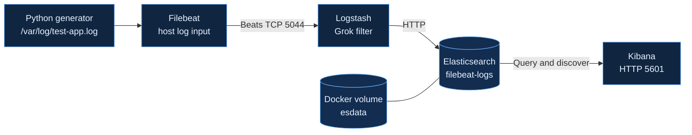

<div align="center">


<br/>

[](https://www.elastic.co/elastic-stack)
[](https://docs.docker.com/compose/)
[](https://github.com/Centaur4/elk-stack-dev/actions/workflows/elk-ci.yml)
[](#scope--security)

**A hands-on, Docker Compose–based log ingestion and search lab.**  
Collect host logs with Filebeat, transport them through Logstash, index them in Elasticsearch, and explore them using Kibana.

[Architecture](#architecture) · [Quick Start](#quick-start) · [Explore Data](#explore-the-data) · [Project Structure](#project-structure) · [Security](#scope--security)

</div>

---

## ✨ Overview

A development and learning environment for exploring an Elastic Stack log pipeline. It contains four containerized services, a Python log generator, a sample Logstash pipeline, and a basic GitHub Actions workflow.

| Component | Role | Current configuration |
|:--|:--|:--|
| **Filebeat** | Read host log file | Elastic 8.13.4 |
| **Logstash** | Receive Beats events and run Grok | Elastic 8.13.4 · TCP `5044` |
| **Elasticsearch** | Store and search logs | Elastic 8.13.4 · HTTP `9200` |
| **Kibana** | Explore indexed events | Elastic 8.13.4 · HTTP `5601` |
| **Python generator** | Write demo messages every five seconds | `log-generator.py` |
| **GitHub Actions** | Run a basic Elasticsearch health check | `.github/workflows/elk-ci.yml` |

> **Status:** Small local development lab, **not** a production-ready observability platform.

## 🧭 Architecture



**Flow:** A Python script appends messages to `/var/log/test-app.log` on the **Docker host**. Filebeat reads that host file from a read-only `/var/log` bind mount, sends events to Logstash, and Logstash indexes them in Elasticsearch for discovery in Kibana.

> **Parsing caveat:** the provided Logstash filter uses `%{COMMONAPACHELOG}`, while the Python generator writes ordinary Python log lines. These events can carry a `_grokparsefailure` tag but still reach Elasticsearch. Improving this mismatch is a planned task.

## ⚡ Quick Start

### Prerequisites

- Docker Engine and the Docker Compose plugin
- Git and Python 3
- A disposable lab VM or development computer with several GB of available RAM
- Ports `9200`, `5601`, `5044`, `9600` available

**Security warning:** The current Compose file disables Elasticsearch authentication and publishes ports on the host. Use **only on an isolated lab machine**, not on a public production server.

### 1. Clone and launch

```bash
git clone https://github.com/Centaur4/elk-stack-dev.git
cd elk-stack-dev
docker compose up -d
docker compose ps
```

Elasticsearch's JVM heap is set to **1 GiB**; other services need additional memory.

### 2. Verify Elasticsearch

```bash
curl -s 'http://localhost:9200/_cluster/health?pretty'
```

### 3. Generate logs

Run this **on the same Docker host**, not on a separate container:

```bash
sudo python3 log-generator.py
```

The script writes to `/var/log/test-app.log` every five seconds. Stop it with **Ctrl+C**. Writing to `/var/log` usually requires elevated permission.

### 4. Verify ingestion

In another terminal:

```bash
docker compose logs -f filebeat logstash
```

Inspect available indices and the example document count:

```bash
curl -s 'http://localhost:9200/_cat/indices?v'
curl -s 'http://localhost:9200/filebeat-logs/_count?pretty'
```

The `filebeat-logs` index appears only after Logstash receives and forwards events.

## 🔎 Explore the Data

Open **http://localhost:5601** in a browser on the development host.

1. Open **Stack Management → Data Views** and add `filebeat-logs*` if the index exists.
2. Open **Discover** and choose the data view.
3. Inspect `message`, `@timestamp`, `host`, and `tags` fields.
4. Look for `_grokparsefailure` in tags to identify the sample-format parsing mismatch.

### Operational commands

```bash
docker compose ps                     # Show containers
docker compose logs -f logstash       # Inspect processing
docker compose logs -f filebeat       # Inspect log collection
docker compose down                   # Stop containers
docker compose down -v                # Remove containers AND saved ES data
```

> **Data safety:** The `esdata` named volume persists data across ordinary restarts. `docker compose down -v` deletes that volume.

## 🗂️ Project Structure

```text
elk-stack-dev/
├── .github/workflows/elk-ci.yml
├── assets/elk-stack-banner.svg
├── data/logs-sample.json               # Empty placeholder
├── elasticsearch/config/elasticsearch.yml
├── filebeat/filebeat.yml
├── kibana/config/kibana.yml
├── logstash/
│   ├── config/logstash.yml             # Empty placeholder
│   └── pipeline/logstash.conf
├── notebooks/anomaly_detection.ipynb   # Empty placeholder
├── .env                                # Empty placeholder
├── docker-compose.yml
├── log-generator.py
└── README.md
```

**Configuration accuracy:** The current Compose file explicitly mounts Filebeat's config and Logstash's pipeline. The standalone Elasticsearch and Kibana YAML config files are present in the repository, but are **not mounted in the current Compose definition**; their Compose environment settings are used instead.

## 🧪 Continuous Integration

The [CI workflow](.github/workflows/elk-ci.yml) runs on pushes and pull requests to `main`. It starts the Compose stack, waits for initialization, checks Elasticsearch cluster health, and tears down the stack.

This is a **basic smoke check**. It currently does **not** verify end-to-end Filebeat → Logstash → Elasticsearch ingestion or Kibana availability. The existing health command expects `green`, so it may need more resilient readiness logic in the future.

## 🔐 Scope & Security

- Elasticsearch runs as a **single node** with `xpack.security.enabled=false`.
- Exposed host ports must not be reachable by untrusted networks.
- Filebeat runs as root inside its container and mounts host `/var/log` read-only.
- Elasticsearch stores data in the `esdata` named volume.
- Sample JSON and anomaly-detection notebook files are **currently empty**, not functioning demonstrations.
- Production use would require TLS, authentication, restricted bind addresses, resource controls, secret handling, and broader verification.

## 🛣️ Roadmap

- [ ] Align Grok parsing with actual Python-generated log format.
- [ ] Implement deterministic ingestion checks, including Elasticsearch document counts.
- [ ] Replace fixed CI sleeps with service readiness polling.
- [ ] Add reproducible screenshots and Kibana data views.
- [ ] Restrict default networking for local use and document secure deployment.
- [ ] Build and evaluate a real anomaly-detection example when suitable sample data is available.

## 👤 Maintainer

**Amir Mohammad Ranjbar**  
AI Engineer & Systems Architect · PhD Researcher in Artificial Intelligence

[GitHub](https://github.com/Centaur4) · [Personal Portfolio](https://centaur4.github.io/) · [LinkedIn](https://www.linkedin.com/in/amir-mohammad-ranjbar) · [Google Scholar](https://scholar.google.com/citations?user=XSt4dGwAAAAJ)

<div align="center">

**Observe the signal. Understand the system.**

<sub>Built for hands-on learning and reproducible engineering experiments.</sub>

</div>
